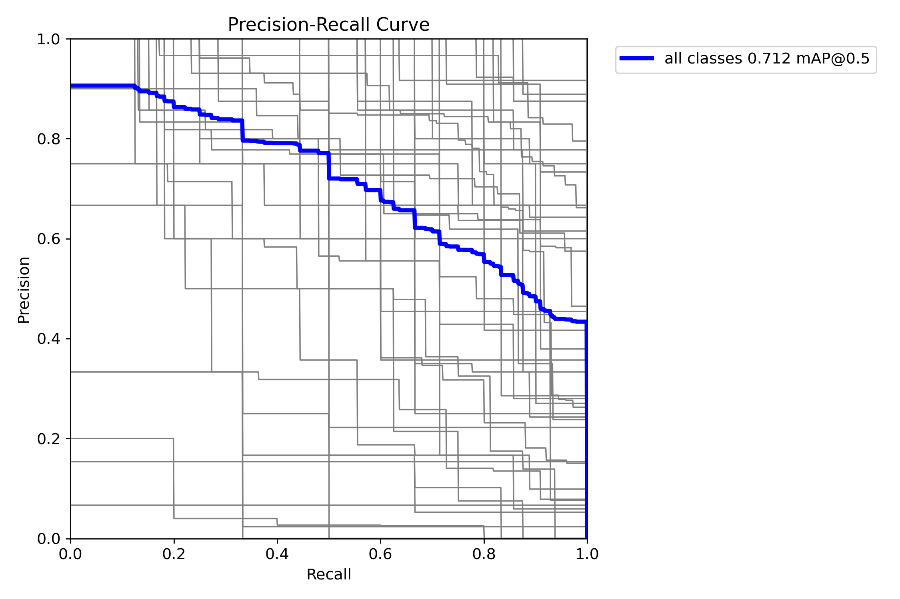
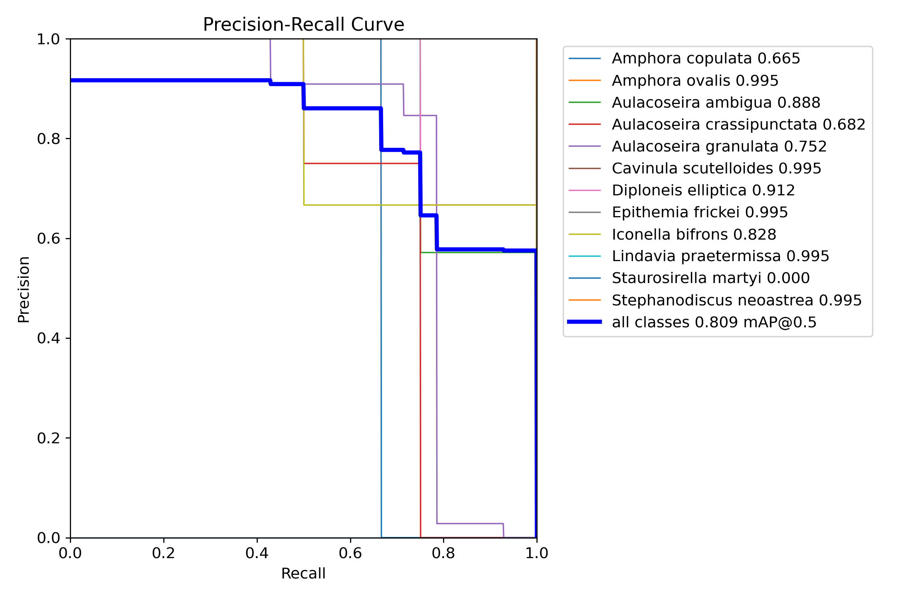

# Automatic Diatom Identification from Photographs

This project provides an ML pipeline for detecting and identifying diatom
species in microscope photographs. It was developed with support from Yandex
Cloud and the Institute of Geography of the Russian Academy of Sciences.

The project addresses a task that is often performed manually by researchers:
estimating the abundance and diversity of diatoms for water-quality
assessment, climate research, and related environmental studies.


## Approach

The solution is a one- or two-stage pipeline:

1. **Detection:** YOLOv11 finds diatom instances and their bounding boxes, then automatically classifies them.
2. **Classification:** optional DiatomNet classification in place of YOLO's.


### Datasets

Two datasets were used. Their species basically don't overlap, which makes the dataset comparison especially informative:

- **Institute (proprietary) dataset:** approximately 1,000 images and 46 species. Species
  represented by fewer than 10 images were removed, leaving 12 species for
  the reduced evaluation dataset.
- **Open dataset by Hüseyin Gündüz:** approximately 2,200 images and 51
  species, used without removing species.


## Final results

YOLOv11 metrics describe 1-stage pipeline, while DiatomNet metrics describe 2 stage pipeline
(YOLOv11 detection + Diatomnet classification).

### YOLOv11

| Dataset | Macro F1 | Recall | mAP@50 | mAP@50-95 |
|---|---:|---:|---:|---:|
| Institute dataset (reduced) | 0.74 | 0.83 | 0.80 | 0.61 |
| Open dataset | 0.64 | 0.93 | 0.71 | 0.65 |

### DiatomNet

| Dataset | Macro F1 | Recall | Accuracy |
|---|---:|---:|---:|
| Institute dataset (reduced) | 0.45 | 0.43 | 0.70 |
| Open dataset | 0.69 | 0.69 | 0.81 |

The results show that the pipeline can work well for completely different species.

### Precision-recall curves (generated automatically only for YOLO)

Open dataset:



Institute dataset (reduced):



See other visializations in [`runs/detect/diatoms/v2`](runs/detect/diatoms/v2) and [`runs/detect/diatoms/v3_kaggle`](runs/detect/diatoms/v3_kaggle)


## Demo

(Click the relaunch button if it appears)

<https://diatom-classification.streamlit.app/>

The source code for the interface is
[`src/streamlit_app.py`](./src/streamlit_app.py).

## Repository structure

```text
.
├── configs/                         # DataSphere and training configurations
│   ├── config.yaml                  # Main cloud training job
│   └── config.*.yaml                # Smoke-test configurations
├── dataset_preprocess/
│   ├── xml_to_yolov11.py            # VOC XML to YOLO conversion and splitting
│   └── data/                        # YOLO dataset and class definitions
├── model_weights/
│   ├── detectors/                   # YOLO detector checkpoints (.pt)
│   └── classifiers/                 # DiatomNet checkpoints (.pth)
├── notebooks/                       # EDA and exploratory experiments
├── runs/                            # Training and validation outputs
├── scripts/
│   ├── train_detector.py            # Train and validate the detector
│   ├── train_classifier.py          # Train DiatomNet separately
│   ├── train_pipeline.py            # Train detector + classifier pipeline
│   └── evaluate.py                  # Evaluate the complete pipeline
├── src/
│   ├── models/                      # Detector, classifier, and pipeline code
│   ├── config.py                    # Paths, classes, and hyperparameters
│   ├── dataset.py                   # Dataset loading utilities
│   └── streamlit_app.py             # Web application
├── requirements.txt                 # Full local environment
└── requirements-cloud.txt           # Minimal DataSphere environment
```

## Run the web application locally

The Streamlit application loads the detector and matching classifier from
`model_weights/`:

```bash
streamlit run src/streamlit_app.py
```

The application accepts microscope images, runs the detection/classification
pipeline, and displays the predicted species, confidence scores, and
bounding boxes.

## Training launch

Run the complete two-stage pipeline:

```bash
python -m scripts.train_pipeline
```

Or train each component independently:

```bash
python -m scripts.train_detector
python -m scripts.train_classifier
```

Training configuration, dataset paths, class names, and output locations are
defined in [`src/config.py`](./src/config.py).
The default configuration uses CUDA when available and falls back to CPU.

## Run in Yandex Cloud DataSphere with ClearML

The main DataSphere job can be started with:

```bash
datasphere project job execute -p bt122c1et3ueiori55qf -c configs/config.yaml
```

For ClearML tracking, configure `CLEARML_API_ACCESS_KEY` and
`CLEARML_API_SECRET_KEY`. If a self-hosted ClearML instance is used, also set
`CLEARML_API_HOST`, `CLEARML_WEB_HOST`, and `CLEARML_FILES_HOST`.

Do not commit credentials. Use environment variables or the platform's secret
storage.
